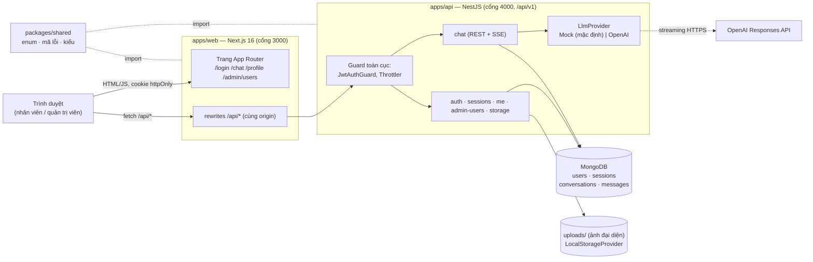
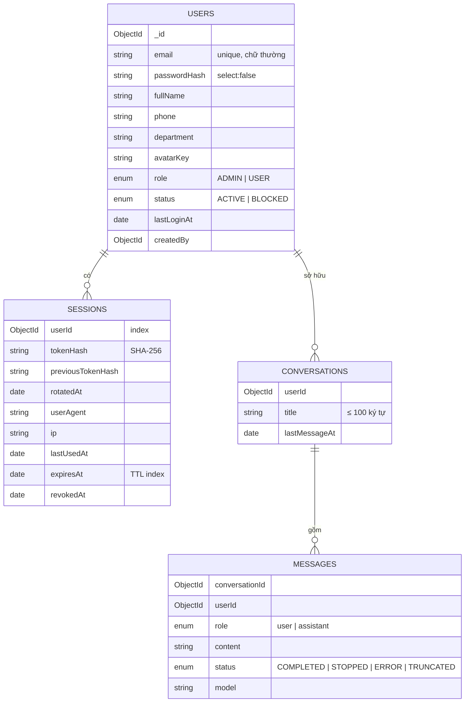
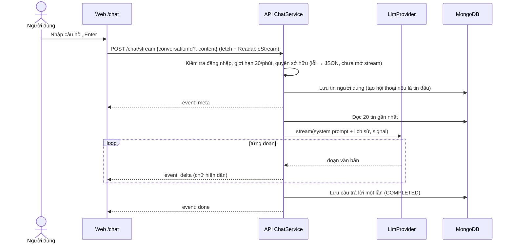

# 02 — Yêu cầu và thiết kế hệ thống

Cơ sở: `origin/develop` @ `6ed0fbc` (code = `fbffd5b`) · Người lập: TL · Trạng thái: **Chờ Review (vòng 4, 16/11/2026)** — PR #3 (`1674425`), PR #4 (`d6832e0`) đã tích hợp; code ứng dụng `d6832e0`
Tài liệu này tóm tắt và dẫn về Function Spec / Basic Design đã có, không thay thế chúng. Mỗi mục ghi rõ **[Đã kiểm chứng]** (có code tại SHA cơ sở và có bằng chứng kiểm thử), **[PR]** (đã kiểm thử trên PR, chưa tích hợp — vòng 4: không còn mục nào) hoặc **[Dự kiến]** (thiết kế/đề cương, chưa có code).

## 1. Bài toán

Doanh nghiệp có nhiều tài liệu nội bộ; nhân viên mất thời gian tìm và đọc. Các dịch vụ chatbot công cộng không bảo đảm dữ liệu nằm trong phạm vi kiểm soát của tổ chức. CAT GPT là trợ lý AI **nội bộ**: chỉ người được cấp tài khoản mới dùng được, mỗi người chỉ thấy dữ liệu của mình, và lớp AI được tách thành "provider" để có thể chọn dịch vụ API hoặc mô hình chạy nội bộ (nguồn: đề cương — [01 mục 2](01-outline-and-sources.md#2-mục-tiêu)).

Phạm vi giai đoạn hiện thực: Module 1 (tài khoản) và Module 2 (hội thoại). Module 3–4 (tài liệu, RAG) có thiết kế ở mức đề cương và giao diện minh họa — mục 8.

## 2. Yêu cầu

### 2.1. Yêu cầu chức năng

| Mã | Yêu cầu | Tác nhân | Trạng thái | Nguồn |
|---|---|---|---|---|
| FR-01 | Đăng nhập bằng email + mật khẩu; không có tự đăng ký | Khách | [Đã kiểm chứng] | [module-1 §1 Q7–Q8](../design/module-1-auth.md#1-yêu-cầu-đã-chốt-với-sinh-viên) |
| FR-02 | Đăng xuất; tự gia hạn phiên ngầm khi còn hoạt động | NV, QTV | [Đã kiểm chứng] | [module-1 §2.1](../design/module-1-auth.md#21-token-so-sánh-và-lựa-chọn) |
| FR-03 | Xem/sửa hồ sơ (họ tên, SĐT, phòng ban), tải/xóa ảnh đại diện | NV, QTV | [Đã kiểm chứng] | module-1 §1 Q12, §5 |
| FR-04 | Ảnh đại diện chỉ chính chủ xem được | NV, QTV | [Đã kiểm chứng] PR #3 → `1674425` | [SE-002](../tasks/SE-002-avatar-requires-login.md); CS-4 |
| FR-05 | Đổi mật khẩu (cần mật khẩu hiện tại); thu hồi các phiên khác | NV, QTV | [Đã kiểm chứng] | module-1 §2.4 |
| FR-06 | Xem phiên đăng nhập (thiết bị, IP, lần hoạt động cuối); đăng xuất từng thiết bị / tất cả thiết bị khác | NV, QTV | [Đã kiểm chứng] | module-1 §4–5 |
| FR-07 | Quản trị: danh sách tài khoản (tìm, lọc vai trò/trạng thái, phân trang); tạo; sửa; đổi vai trò | QTV | [Đã kiểm chứng] | module-1 §4–5 |
| FR-08 | Khóa/mở khóa tài khoản; khóa có hiệu lực ở request kế tiếp | QTV | [Đã kiểm chứng] | module-1 §2.2 |
| FR-09 | Đặt lại mật khẩu cho người khác (thu hồi mọi phiên của họ); không xóa tài khoản | QTV | [Đã kiểm chứng] | module-1 §1 Q11, §2.4 |
| FR-10 | Gửi tin nhắn, nhận câu trả lời hiện dần (streaming SSE); hội thoại tạo khi gửi tin đầu | NV, QTV | [Đã kiểm chứng] — nội dung là văn bản mẫu | [module-2 §2.1, §4.3](../design/module-2-chat.md#43-api-prefix-apiv1) |
| FR-11 | Dừng câu trả lời đang sinh; phần đã sinh được lưu | NV, QTV | [Đã kiểm chứng] | module-2 §2.2, §4.4 |
| FR-12 | Tạo lại câu trả lời cuối; sao chép câu trả lời | NV, QTV | [Đã kiểm chứng] | module-2 §2.2 |
| FR-13 | Danh sách hội thoại (nhóm theo thời gian, tìm theo tiêu đề), đổi tên, xóa; mở lại hội thoại cũ thấy đủ lịch sử | NV, QTV | [Đã kiểm chứng] | module-2 §2.1–2.2 |
| FR-14 | Trả lời bằng LLM thật (OpenAI), giới hạn độ dài 1.000 token, nhãn "Câu trả lời bị cắt…" khi chạm giới hạn | NV, QTV | [Đã kiểm chứng] PR #4 → `d6832e0` | [SE-007](../tasks/SE-007-openai-provider.md) |
| FR-15 | Quản lý tài liệu, pipeline embedding | NV | [Dự kiến] | Đề cương Module 3 |
| FR-16 | Hỏi–đáp, tóm tắt tài liệu có trích dẫn (RAG) | NV | [Dự kiến] | Đề cương Module 4 |

NV = nhân viên (`USER`), QTV = quản trị viên (`ADMIN`).

### 2.2. Yêu cầu phi chức năng

| Mã | Yêu cầu | Cách đáp ứng | Trạng thái | Nguồn |
|---|---|---|---|---|
| NFR-01 | Bảo mật phiên | Token trong cookie httpOnly `SameSite=Lax` (không localStorage); refresh token lưu băm SHA-256; rotation + phát hiện dùng lại | [Đã kiểm chứng] | module-1 §2.1 |
| NFR-02 | Bảo mật mật khẩu | bcrypt 10 rounds; 8–64 ký tự, có chữ và số; chống dò tài khoản qua thời gian phản hồi (M1-08) | [Đã kiểm chứng] | module-1 §2.3–2.4 |
| NFR-03 | Chống lạm dụng | Đăng nhập 5 lần/phút/IP; toàn API 120 request/phút/IP; Chat 20 lần/phút/người | [Đã kiểm chứng] | module-1 §2.4; `chat-throttler.guard.ts` |
| NFR-04 | Cách ly dữ liệu | Mọi truy vấn Chat lọc theo `userId`; hội thoại người khác trả `404` (không lộ tồn tại); quyền quản trị không mở quyền đọc nội dung | [Đã kiểm chứng] | [access-control §1](../design/access-control.md#1-nguyên-tắc-đang-áp-dụng-đã-xác-minh-trong-code) |
| NFR-05 | Phản hồi tức thời | SSE, heartbeat 15 giây; chữ hiện dần ngay khi có | [Đã kiểm chứng] | module-2 §4.4 |
| NFR-06 | Đa ngôn ngữ, giao diện sáng/tối, responsive | next-intl (vi/en, cookie), next-themes, bố cục mobile | [Đã kiểm chứng] | D-08, D-09; module-1 §5 |
| NFR-07 | Dễ thay nhà cung cấp AI / lưu trữ | Lớp trừu tượng `LlmProvider`, `StorageService` (đầu chờ) | [Đã kiểm chứng] (mock, OpenAI, local) | M1-07; module-2 §4.5 |
| NFR-08 | Khóa API AI không lộ | Key chỉ ở `apps/api/.env` (không commit); log chỉ ghi số token, không ghi nội dung | [Đã kiểm chứng] PR #4 → `d6832e0` | SE-007 AC |
| NFR-09 | Sẵn sàng cho 500 nhân sự (R-1…R-10) | Tiêu chí đã chốt; **chưa đo** | [Dự kiến] | [ui-release-standards](../design/ui-release-standards.md); SE-005 |
| NFR-10 | Triển khai on-premise bằng Docker | Chưa đóng gói | [Dự kiến] | Đề cương; D-04 |
| NFR-11 | Phát hành theo giai đoạn (bản demo / bản nhân viên) | `RELEASE_MODE=demo\|staff` (API) + `NEXT_PUBLIC_RELEASE_MODE` (web): `staff` ẩn Tài liệu, ẩn Chat khi LLM còn là bản mẫu (`GET /me/features` → `chatEnabled`; API Chat trả `404`), Swagger mặc định tắt | [Đã kiểm chứng] PR #6 → `783a8a3` | [SE-003](../tasks/SE-003-release-mode-navigation.md); CS-6 |

## 3. Tác nhân và phân quyền

Hai vai trò `ADMIN` / `USER` (module-1 Q10). Ma trận đầy đủ, đã kiểm tra bằng hai tài khoản nhân viên + một admin trên `develop` @ `06a5a83`: [access-control.md mục 2](../design/access-control.md#2-ma-trận-vai-trò--màn-hình--thao-tác--dữ-liệu--khi-thiếu-quyền). Tóm tắt để đưa vào báo cáo:

| Chức năng | Khách | Nhân viên (`USER`) | Quản trị viên (`ADMIN`) | Khi thiếu quyền |
|---|---|---|---|---|
| Đăng nhập | ✔ | — | — | — |
| Hồ sơ, đổi mật khẩu, phiên của mình | ✘ | ✔ | ✔ | Chưa đăng nhập → chuyển `/login`; API `401` |
| Ảnh đại diện | ✘ | Chỉ ảnh của mình [Đã tích hợp — PR #3] | Chỉ ảnh của mình [Đã tích hợp — PR #3] | `401` / `404` |
| Trò chuyện (hội thoại của mình) | ✘ | ✔ | ✔ | Hội thoại người khác → `404 CONVERSATION_NOT_FOUND` (cả admin) |
| Quản trị tài khoản | ✘ | ✘ | ✔ | UI "Không có quyền truy cập"; API `403 FORBIDDEN` |
| Tự khóa / tự hạ quyền mình; hạ admin cuối cùng | — | — | ✘ | `400 USER_CANNOT_MODIFY_SELF` / `USER_LAST_ADMIN` |

CS-6 (chế độ phát hành `staff`) **đã hiện thực** — SE-003, merge `783a8a3` (17/11/2026). Chính sách đã chốt nhưng chưa hiện thực (CS-2 chặn admin đặt lại mật khẩu admin khác, CS-3 đổi email thu hồi phiên, CS-4 bỏ SĐT khỏi màn quản trị) thuộc SE-006 — [Dự kiến] ([access-control mục 4](../design/access-control.md#4-chính-sách-đã-chốt)).

## 4. Kiến trúc tổng thể



Điểm thiết kế cần giải thích trong báo cáo:
- **Cùng origin qua rewrites (D-11):** trình duyệt chỉ nói chuyện với cổng web; Next.js chuyển `/api/*` sang NestJS. Nhờ vậy cookie httpOnly hoạt động mà không cần CORS. Khi triển khai, Nginx đảm nhiệm vai trò này [Dự kiến].
- **Gói dùng chung `packages/shared`:** enum (`UserRole`, `MessageStatus`…), mã lỗi và kiểu dữ liệu dùng chung cho FE/BE; API chỉ trả **mã lỗi**, FE tự dịch theo ngôn ngữ (D-08).
- **Đầu chờ (provider):** nghiệp vụ gọi lớp trừu tượng (`LlmProvider`, `StorageService`); đổi nhà cung cấp chỉ thay provider qua cấu hình (`LLM_PROVIDER=mock|openai`, tích hợp PR #4).
- **Monorepo pnpm + Turborepo (D-01):** một lệnh `pnpm dev` chạy cả hai ứng dụng.

## 5. Thiết kế dữ liệu (MongoDB)

Nguồn: schema trong code tại SHA cơ sở; thiết kế gốc ở [module-1 §3](../design/module-1-auth.md#3-dữ-liệu-mongodb), [module-2 §4.2](../design/module-2-chat.md#42-dữ-liệu-mongodb).



| Collection | Index | Mục đích | File |
|---|---|---|---|
| `users` | `email` unique; `role`; `status`; `createdAt` | Đăng nhập, lọc danh sách quản trị | `apps/api/src/modules/users/schemas/user.schema.ts` |
| `sessions` | `userId`; `{userId, revokedAt}`; TTL `expiresAt` | Kiểm tra phiên mỗi request; MongoDB tự xóa phiên hết hạn | `apps/api/src/modules/sessions/schemas/session.schema.ts` |
| `conversations` | `{userId, lastMessageAt -1, _id -1}` | Danh sách hội thoại của người dùng, phân trang cursor | `apps/api/src/modules/chat/schemas/conversation.schema.ts` |
| `messages` | `{conversationId, createdAt}` | Đọc lịch sử theo thứ tự | `apps/api/src/modules/chat/schemas/message.schema.ts` |

Khác biệt thiết kế ↔ hiện thực: thiết kế Module 2 có trường `usage?` trong `messages`; code **không lưu** usage vào DB (PR #4 chỉ ghi số token ra log). Báo cáo trình bày theo hiện thực.

## 6. Hợp đồng API

Prefix `/api/v1`; tài liệu tương tác bằng Swagger tại `/api/v1/docs`. Lỗi có định dạng thống nhất `{ statusCode, code, message, details?, path, timestamp }`, `code` lấy từ `packages/shared/src/error-codes.ts`. Mọi endpoint yêu cầu đăng nhập trừ `POST /auth/login|refresh|logout`, `GET /health`.

| Nhóm | Endpoint | Ghi chú | File controller |
|---|---|---|---|
| Xác thực | `POST /auth/login` · `POST /auth/refresh` · `POST /auth/logout` | Login 5 lần/phút/IP | `modules/auth/auth.controller.ts` |
| Cá nhân | `GET /me` · `PATCH /me` · `POST /me/avatar` · `DELETE /me/avatar` · `PATCH /me/password` | Không sửa được `role`, `email` (`400`) | `modules/me/me.controller.ts` |
| Phiên | `GET /me/sessions` · `DELETE /me/sessions/:id` · `DELETE /me/sessions` | Phiên người khác → `404 SESSION_NOT_FOUND` | `modules/me/me.controller.ts` |
| Quản trị | `GET /admin/users` · `POST /admin/users` · `GET /admin/users/:id` · `PATCH /admin/users/:id` · `PATCH /admin/users/:id/status` · `POST /admin/users/:id/reset-password` | `@Roles(ADMIN)`; USER → `403` | `modules/admin-users/admin-users.controller.ts` |
| Ảnh đại diện | `GET /files/avatars/:file` | Yêu cầu đăng nhập, chỉ chính chủ (PR #3 → `1674425`); trước đó phục vụ tĩnh không cần đăng nhập (KT-1, đã đóng) | `files.controller.ts` |
| Hội thoại | `GET /conversations?q=&cursor=&limit=` · `GET /conversations/:id` · `PATCH /conversations/:id` · `DELETE /conversations/:id` · `GET /conversations/:id/messages` | Lọc theo `userId` | `modules/chat/conversations.controller.ts` |
| Chat (SSE) | `POST /chat/stream` · `POST /conversations/:id/regenerate` | `text/event-stream`; 20 lần/phút/người | `modules/chat/chat.controller.ts` |
| Chat | `POST /conversations/:id/stop` | `204`; dừng câu trả lời đang sinh | `modules/chat/chat.controller.ts` |
| Khác | `GET /health` | Công khai | `modules/health/health.controller.ts` |

**Sự kiện SSE** ([module-2 §4.4](../design/module-2-chat.md#44-giao-thức-sse)): `meta` (id hội thoại, tin người dùng, tiêu đề) → `delta` (nhiều lần, `{text}`) → `done` (`{messageId, status}`) hoặc `error` (`{code}`); comment `: ping` mỗi 15 giây.

## 7. Luồng tiêu biểu

### 7.1. Đăng nhập, gọi API và gia hạn phiên [Đã kiểm chứng]

```mermaid
sequenceDiagram
  actor U as Người dùng
  participant W as Web (Next.js)
  participant A as API (NestJS)
  participant D as MongoDB
  U->>W: Email + mật khẩu
  W->>A: POST /auth/login
  A->>D: Tìm user, so bcrypt (luôn chạy, kể cả email không tồn tại)
  A->>D: Tạo session (lưu SHA-256 của refresh secret)
  A-->>W: Set-Cookie access (15 phút), refresh (7 ngày, chỉ /api/v1/auth), cat_session
  W->>A: GET /me (cookie access)
  A->>D: JwtStrategy: phiên còn hiệu lực? tài khoản ACTIVE?
  A-->>W: 200 hồ sơ
  Note over W,A: Access hết hạn → 401
  W->>A: POST /auth/refresh (cookie refresh)
  A->>D: So hash; xoay token (giữ hash cũ 30 giây ân hạn)
  A-->>W: Cặp cookie mới; interceptor axios gửi lại request cũ
```

Khóa tài khoản: admin đổi `status=BLOCKED` → thu hồi mọi phiên → request kế tiếp của người bị khóa nhận `401 AUTH_ACCOUNT_BLOCKED`, web chuyển `/login?reason=blocked` ([module-1 §2.2](../design/module-1-auth.md#22-khóa-tài-khoản-có-hiệu-lực-ngay)).

### 7.2. Gửi tin nhắn và nhận câu trả lời streaming [Đã kiểm chứng]



### 7.3. Dừng giữa chừng [Đã kiểm chứng]

Người dùng bấm **Dừng** → web gọi `POST /conversations/:id/stop`; nếu chưa có id hội thoại hoặc lời gọi lỗi thì hủy request stream bằng `AbortController` (server nhận kết nối đóng) → API hủy `signal` của lượt đang chạy → provider ngừng sinh → phần đã sinh được lưu với trạng thái `STOPPED`, hiện nhãn "Đã dừng" cả sau khi mở lại. Nguồn: [module-2 §4.4](../design/module-2-chat.md#44-giao-thức-sse) bước 6; `apps/api/src/modules/chat/chat.controller.ts` (`stop`), `apps/web/src/features/chat/chat-stream-provider.tsx` (`stop`); kiểm thử ở SE-001.

### 7.4. Ba cách kết thúc khi dùng OpenAI

| Tình huống | Tín hiệu từ provider | Trạng thái lưu | Giao diện |
|---|---|---|---|
| Trả lời xong | `response.completed` | `COMPLETED` | Không nhãn |
| Chạm giới hạn 1.000 token | `response.incomplete` (`max_output_tokens`) | `TRUNCATED`, giữ phần đã sinh | "Câu trả lời bị cắt do đạt giới hạn độ dài" |
| Người dùng bấm Dừng | Request tới OpenAI bị hủy (kết nối đóng) | `STOPPED` | "Đã dừng" |

Nguồn: [SE-007](../tasks/SE-007-openai-provider.md); [module-2 §4.5](../design/module-2-chat.md). Đã tích hợp (merge `d6832e0`, 16/11/2026), TL xác minh ba kết thúc với mock trên `develop` — [báo cáo ngày 16/11 vòng 3](../reports/daily/2026-11-16.md#vòng-3--0058).

## 8. Thiết kế dự kiến Module 3–4 [Dự kiến]

Đã có Function Spec / Basic Design: [Module 3](../design/module-3-documents.md) (CTO duyệt 17/11/2026) và [Module 4](../design/module-4-rag.md) (chờ duyệt); **chưa có code** phía máy chủ (Module 3 bắt đầu bằng SE-010/SE-011). Cho tới khi có code + kiểm thử, báo cáo trình bày ở mức **thiết kế**, dẫn hai tài liệu trên:
- Module 3: tải tệp lên (PDF text, DOCX, TXT) → lưu MinIO → hàng đợi Redis/BullMQ → bóc tách văn bản → chia đoạn → sinh embedding đa ngữ → lưu Qdrant; theo dõi trạng thái xử lý.
- Module 4: truy hồi đoạn liên quan theo câu hỏi → LLM sinh câu trả lời kèm trích dẫn nguồn; tóm tắt tài liệu; dùng lại khung Chat (cùng `LlmProvider`, cùng SSE — [module-2 §1](../design/module-2-chat.md#1-bối-cảnh)).
- Mô tả trong báo cáo: **thiết kế và giao diện minh họa** (CTO chốt 15/11/2026, T3).
- Giao diện minh họa ở nhánh preview (Hình 7–14 của báo cáo 27/10) là **dữ liệu giả trong trình duyệt** — nếu đưa vào báo cáo phải chú thích "giao diện minh họa, chưa kết nối máy chủ" ([audit mục 3.3–3.4](../project/preview-progress-review.md#33-module-3--quản-lý-tài-liệu-hình-79)).

## 9. Sơ đồ: file nguồn hiện có và việc cần xuất / vẽ lại

Quy định Khoa: hình thiết kế phải **tự vẽ bằng phần mềm thiết kế**, nộp kèm file hình; cấm sao chép hình thiết kế từ tài liệu khác ([01 mục 8](01-outline-and-sources.md#8-quy-định-trình-bày-của-khoa-áp-dụng-khi-dựng-word) — Q12, nguồn: QĐ tr. 2 §2.4). Sơ đồ trong bộ nguồn viết bằng **Mermaid** (văn bản, xem được trên GitHub) — là nguồn nội dung, chưa phải hình nộp. Đề xuất: xuất SVG/PNG bằng Mermaid CLI (`npx -y @mermaid-js/mermaid-cli -i <file>.mmd -o <file>.svg`) hoặc vẽ lại bằng draw.io (diagrams.net), lưu file nguồn `.mmd` / `.drawio` cùng ảnh xuất trong `docs/thesis/diagrams/` để nộp kèm.

| Mã | Sơ đồ | Chương | File nguồn hiện có | Trạng thái | Việc cần làm |
|---|---|---|---|---|---|
| D1 | Kiến trúc tổng thể Web – API – MongoDB – AI | 2.3 | Mermaid tại [mục 4](#4-kiến-trúc-tổng-thể) | Có nội dung, đã đối chiếu code @ `6ed0fbc` | Xuất hoặc vẽ lại (nhãn [PR #4] đã bỏ — đã tích hợp) |
| D2 | ERD 4 collection | 2.4 | Mermaid tại [mục 5](#5-thiết-kế-dữ-liệu-mongodb) | Có nội dung, theo schema trong code | Xuất hoặc vẽ lại; đã có `TRUNCATED` |
| D3 | Tuần tự đăng nhập / gia hạn phiên | 2.6 | Mermaid tại [mục 7.1](#71-đăng-nhập-gọi-api-và-gia-hạn-phiên-đã-kiểm-chứng) | Có nội dung | Xuất hoặc vẽ lại |
| D4 | Tuần tự gửi tin nhắn + streaming | 2.6 | Mermaid tại [mục 7.2](#72-gửi-tin-nhắn-và-nhận-câu-trả-lời-streaming-đã-kiểm-chứng) | Có nội dung | Xuất hoặc vẽ lại |
| D5 | Dừng giữa chừng | 2.6 | Văn bản tại [mục 7.3](#73-dừng-giữa-chừng-đã-kiểm-chứng) | Chưa có sơ đồ | Vẽ mới (tuần tự hoặc hoạt động) |
| D6 | Trạng thái tin nhắn trợ lý (`COMPLETED` / `STOPPED` / `ERROR` / `TRUNCATED`) | 2.6 / 3.3 | Bảng tại [mục 7.4](#74-ba-cách-kết-thúc-khi-dùng-openai) | Chưa có sơ đồ | Vẽ mới (PR #4 đã tích hợp) |
| D7 | Use case tổng quát (Khách, Nhân viên, Quản trị viên) | 2.2 | Chưa có — dữ liệu ở [mục 2.1](#21-yêu-cầu-chức-năng), [mục 3](#3-tác-nhân-và-phân-quyền) | **Thiếu** | Vẽ mới (quy định Khoa lấy "sơ đồ use case tổng quát" làm ví dụ) |
| D8 | Use case phân rã Module 1, Module 2 | 2.2 | Chưa có — FR-01…FR-14 | **Thiếu** | Vẽ mới |
| D9 | Cấu trúc module backend / frontend | 3.1 | Bảng tại [context.md mục 4](../project/context.md#4-bản-đồ-mã-nguồn) | Chưa có sơ đồ | Vẽ mới (SE-008 mô tả, TL/sinh viên vẽ) |
| D10 | Kiến trúc dự kiến Module 3–4 (MinIO, BullMQ, Qdrant) | 2.7 | Văn bản tại [mục 8](#8-thiết-kế-dự-kiến-module-34-dự-kiến) | Thiết kế dự kiến | Vẽ mới, chú thích "thiết kế dự kiến" |
| D11 | Triển khai Docker / Nginx | Hướng phát triển | Chưa có | Hướng phát triển | Chỉ vẽ nếu báo cáo cần |
