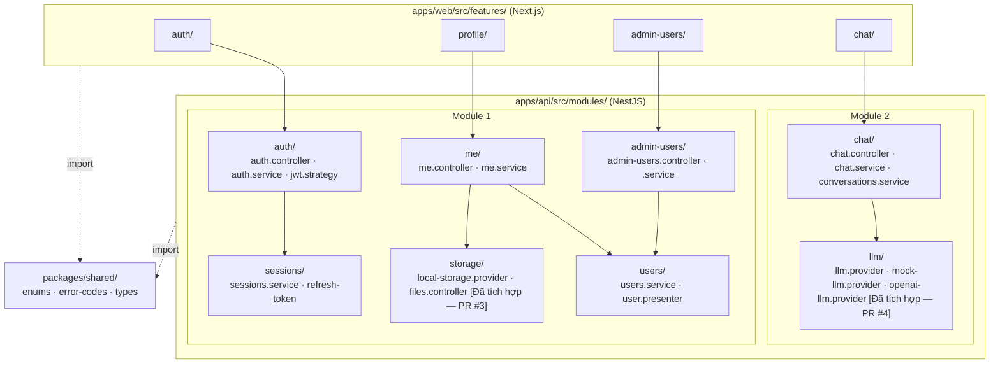

# 03 — Hiện thực Module 1–2

Cơ sở: `origin/develop` @ `2f003a0` (code ứng dụng trùng `fbffd5b`, merge PR #2 — Chat) · Người lập: Senior Dev ([SE-008](../tasks/SE-008-thesis-implementation-evidence.md)) · Trạng thái: Chờ Review (vòng 1) · Cập nhật trạng thái tích hợp: TL, 16/11/2026 ([TL-004 vòng 4](../tasks/TL-004-thesis-source-pack.md#checklist-vòng-4)) — code `d6832e0`

Tài liệu này mô tả **hiện thực thật trong code**, đi sâu hơn phần thiết kế ở [02](02-requirements-and-design.md): tên file, hàm/lớp cụ thể, và Web–API–MongoDB phối hợp ra sao. Mỗi đoạn ghi rõ mức tích hợp theo đúng 4 mức của [README mục 3](README.md#3-trạng-thái-module-tại-sha-cơ-sở). Trích dẫn code kiểm chứng được bằng `git show <sha>:<đường dẫn file>`.

## Bảng trạng thái tích hợp

| Phần | Trạng thái tích hợp | Nguồn |
|---|---|---|
| Module 1 — xác thực, phiên, hồ sơ, quản trị tài khoản | **Đã tích hợp** — `develop` @ `2f003a0` (code = PR #1, merge 27/10/2026) | [module-1-auth.md](../design/module-1-auth.md) |
| Ảnh đại diện chỉ chính chủ xem được (CS-4) | **Đã tích hợp** — PR #3 @ `d60864a`, merge `1674425` (16/11/2026) | [SE-002](../tasks/SE-002-avatar-requires-login.md#lịch-sử-review) |
| Module 2 — hội thoại, streaming SSE, Dừng/Tạo lại (nội dung mẫu) | **Đã tích hợp** — `develop` @ `2f003a0` (code = PR #2 / SE-001, merge `fbffd5b`) | [module-2-chat.md](../design/module-2-chat.md) |
| Provider OpenAI thật (Responses API) | **Đã tích hợp** — PR #4 @ `e1fda76`, merge `d6832e0` (16/11/2026) | [SE-007](../tasks/SE-007-openai-provider.md#lịch-sử-review) |

PR #3 và PR #4 đã tích hợp vào `develop` ngày 16/11/2026 (merge commit, không sửa thêm) và TL xác minh lại trên `develop` @ `d6832e0`: build/typecheck/lint, api test 12/12, quyền ảnh đại diện (`200`/`401`/`404`), ba kết thúc với mock — [báo cáo ngày 16/11 vòng 3](../reports/daily/2026-11-16.md#vòng-3--0058). Nhãn `[Đã tích hợp — PR #3]` / `[Đã tích hợp — PR #4]` ở mục 2 và 3 giữ số PR để truy vết; SHA `d60864a` / `e1fda76` là đầu PR đã review.

## 1. Môi trường và cấu trúc mã nguồn

Monorepo pnpm + Turborepo: `apps/api` (NestJS 12), `apps/web` (Next.js 16 App Router), `packages/shared` (enum, mã lỗi, kiểu DTO dùng chung cho cả hai, ví dụ `UserRole`, `ErrorCode`, `MessageStatus`, `AVATAR_MAX_SIZE_BYTES`, `CHAT_MAX_MESSAGE_LENGTH`). Chạy `pnpm dev` ở gốc khởi động cả hai ứng dụng; `apps/web/next.config.ts` khai báo `rewrites()` chuyển `/api/:path*` sang `${API_INTERNAL_URL}/api/:path*` (NestJS) nên trình duyệt chỉ nói chuyện với một origin, cookie httpOnly hoạt động không cần CORS — xem kiến trúc tổng thể ở [02 mục 4](02-requirements-and-design.md#4-kiến-trúc-tổng-thể). `apps/web/src/proxy.ts` không tham gia việc này; vai trò thật của nó mô tả ở [mục 2.1](#21-đăng-nhập-phiên-và-gia-hạn-ngầm).

**Sơ đồ D9** ([02 mục 9](02-requirements-and-design.md#9-sơ-đồ-file-nguồn-hiện-có-và-việc-cần-xuất--vẽ-lại)) — cấu trúc module của riêng Module 1–2, theo đúng tên thư mục/file thật tại SHA cơ sở (đối chiếu [context.md mục 4](../project/context.md#4-bản-đồ-mã-nguồn)):



`apps/api/src/app.module.ts` đăng ký guard toàn cục theo đúng thứ tự (chống spam → xác thực → phân quyền):

```ts
providers: [
  { provide: APP_GUARD, useClass: ThrottlerGuard },   // 120 request/phút/IP
  { provide: APP_GUARD, useClass: JwtAuthGuard },      // bắt buộc trừ @Public()
  { provide: APP_GUARD, useClass: RolesGuard },        // @Roles(ADMIN) mới kiểm tra
  { provide: APP_FILTER, useClass: AllExceptionsFilter },
],
```

`JwtAuthGuard` (`common/guards/jwt-auth.guard.ts`) đọc decorator `@Public()` để bỏ qua xác thực cho một số route (`POST /auth/login|refresh|logout`, `GET /health`); route nào không gắn thì mặc định yêu cầu đăng nhập — đây là cơ sở của NFR về "mọi endpoint mới mặc định yêu cầu đăng nhập" ([workflow 9.1](../project/workflow.md#91-trách-nhiệm-hai-vai-về-phân-quyền-giao-diện-và-phát-hành)). `RolesGuard` (`common/guards/roles.guard.ts`) đọc `@Roles(UserRole.ADMIN)` trên `admin-users.controller.ts`; thiếu quyền ném `403 FORBIDDEN`.

## 2. Module 1 — Xác thực & quản lý người dùng [Đã tích hợp]

### 2.1. Đăng nhập, phiên và gia hạn ngầm

`AuthService.login` (`apps/api/src/modules/auth/auth.service.ts`) luôn chạy `verifyPassword` kể cả khi không tìm thấy user (so với `DUMMY_PASSWORD_HASH`) để thời gian phản hồi giống nhau dù email tồn tại hay không (M1-08); chỉ sau khi mật khẩu đúng mới kiểm tra `status === BLOCKED` — tránh lộ trạng thái tài khoản cho người không biết mật khẩu. Đăng nhập thành công gọi `SessionsService.create` (`modules/sessions/sessions.service.ts`) tạo một bản ghi `sessions`, rồi ký access token bằng `signAccessToken(userId, sessionId)`.

Refresh token không lưu trực tiếp trong DB: `modules/sessions/refresh-token.ts` sinh `secret` 256 bit ngẫu nhiên, ghép thành chuỗi `<sessionId>.<secret>` gửi cho client, còn DB chỉ lưu SHA-256 của secret (`hashSecret`) — lộ DB không lộ được token thật. `SessionsService.rotate` so `presentedHash` với `tokenHash` hiện tại; nếu khớp thì cấp secret mới (xoay vòng) và **gia hạn trượt** thêm `refreshTtlDays` kể từ lúc dùng. Nếu không khớp hiện tại nhưng khớp `previousTokenHash` **trong vòng 30 giây** (`REFRESH_REUSE_GRACE_MS`, xử lý trường hợp nhiều tab cùng refresh) thì vẫn chấp nhận; ngoài hai trường hợp đó — token cũ bị dùng lại sau thời gian ân hạn — bị coi là token bị đánh cắp và `revoke()` toàn bộ phiên ngay.

Mỗi request, `JwtStrategy.validate` (`modules/auth/jwt.strategy.ts`) không chỉ kiểm tra chữ ký JWT mà còn truy vấn lại `SessionsService.findActive` và `UsersService.findById`: phiên đã bị thu hồi hoặc tài khoản đã `BLOCKED` thì bị từ chối **ngay ở request kế tiếp**, không cần chờ access token (15 phút) hết hạn — đây là cách hiện thực của "khóa tài khoản có hiệu lực ngay" (mục 2.2 dưới đây) và của đăng xuất từ xa.

Phía web, `apps/web/src/proxy.ts` chỉ đọc cookie gợi ý `cat_session` (giá trị `"1"`, không chứa bí mật — M1-01) để quyết định chuyển hướng sớm tới `/login` hay vào app; việc xác thực thật nằm ở API. Khi một request axios nhận `401` có mã lỗi refresh-được, `apps/web/src/lib/api/client.ts` gọi `refreshSession()` (gộp nhiều request 401 cùng lúc thành một lần gọi `POST /auth/refresh` nhờ biến `refreshPromise` dùng chung) rồi tự gửi lại request cũ — đây là cơ chế "tự gia hạn phiên ngầm" ở FR-02.

### 2.2. Khóa tài khoản có hiệu lực ngay [Đã tích hợp]

`AdminUsersService.setStatus` (`modules/admin-users/admin-users.service.ts`) khi chuyển `status = BLOCKED` gọi `sessions.revokeAllForUser(id)` thu hồi toàn bộ phiên của người đó; `JwtStrategy` ở trên khiến request kế tiếp của người bị khóa nhận `401 AUTH_ACCOUNT_BLOCKED` ngay, kể cả khi access token còn hạn. Hai quy tắc an toàn khác nằm cùng service: `assertNotSelf` (admin không tự khóa/tự hạ quyền chính mình → `400 USER_CANNOT_MODIFY_SELF`) và `assertNotLastActiveAdmin` (`countActiveAdmins() <= 1` → `400 USER_LAST_ADMIN`), áp dụng cho cả `update` (đổi vai trò) lẫn `setStatus`.

### 2.3. Hồ sơ cá nhân, đổi mật khẩu, phiên đăng nhập

`MeService` (`modules/me/me.service.ts`) và `MeController` (`modules/me/me.controller.ts`) phục vụ `GET/PATCH /me`, `PATCH /me/password`, `GET/DELETE /me/sessions[/:id]`. `changePassword` xác minh `currentPassword` bằng `verifyPassword`, từ chối nếu mật khẩu mới trùng mật khẩu cũ (`USER_SAME_PASSWORD`), rồi `sessions.revokeAllForUser(userId, currentSessionId)` — thu hồi mọi phiên **trừ** phiên hiện tại (tham số `exceptSessionId`), khác với admin đặt lại mật khẩu cho người khác (`AdminUsersService.resetPassword` thu hồi **toàn bộ**, không chừa phiên nào, vì admin không biết phiên nào là của người đó).

Ảnh đại diện: `updateAvatar` đọc `magic bytes` qua `detectImageType` (`modules/storage/image-signature.ts`, không tin `Content-Type` client gửi — M1-06), giới hạn `AVATAR_MAX_SIZE_BYTES`, lưu qua `StorageService.save` rồi xóa file cũ (`storage.delete`) nếu có — tránh rác file khi đổi ảnh nhiều lần. `LocalStorageProvider.save` (`modules/storage/local-storage.provider.ts`) đặt tên file bằng `randomUUID()` (không dùng tên gốc, tránh va chạm và lộ thông tin), còn `resolveKey` chặn path traversal bằng cách bắt buộc đường dẫn tuyệt đối sau khi `resolve` phải nằm trong `rootDir`.

**Phục vụ ảnh (trước ↔ sau PR #3):**
- Trước PR #3 (`develop` ≤ `8732458`): `main.ts` gọi `app.useStaticAssets(storage.rootDir, { prefix: LOCAL_FILES_ROUTE, dotfiles: 'deny', maxAge: '7d' })` — route tĩnh của Express, phục vụ **không cần đăng nhập**, trùng với hạn chế KT-1 đã ghi ở [access-control §3](../design/access-control.md). Đây chính là hành vi FR-04 còn thiếu, SE-002 sửa trên PR #3.
- **[Đã tích hợp — PR #3]** `FilesController` (`modules/storage/files.controller.ts`, @ `d60864a`) thay route tĩnh bằng `GET /files/avatars/:file` có `JwtAuthGuard` (không gắn `@Public()`): tra lại `UsersService.findById(authUser.userId)` để lấy `avatarKey` **hiện tại** (JWT không mang trường này), so với key trong URL; không khớp — kể cả admin — ném `NotFoundException` giống hệt trường hợp file không tồn tại, qua `LocalStorageProvider.getAbsolutePath` (public wrapper của `resolveKey`, giữ nguyên chặn path traversal). Header `Cache-Control: private, no-store` (đặt thủ công, kèm `cacheControl: false` trong `res.sendFile` vì mặc định của `send` sẽ ghi đè) đảm bảo trình duyệt không cache lại ảnh cũ sau khi đăng xuất hoặc đổi người dùng.

### 2.4. Quản trị tài khoản

`AdminUsersController` (`admin-users.controller.ts`, gắn `@Roles(ADMIN)`) gọi `AdminUsersService` cho `list` (tìm kiếm/lọc vai trò, trạng thái, phân trang qua `UsersService.list`), `create`, `update`, `setStatus`, `resetPassword`. Không có endpoint xóa người dùng — đúng quyết định Q11 ("không cho phép xóa user").

**[Đã tích hợp — PR #3]** Để tuân thủ CS-4 (ảnh đại diện chỉ chính chủ xem), màn quản trị không được lộ `avatarUrl`: `packages/shared/src/types.ts` thêm `AdminUserDto = Omit<UserDto, 'avatarUrl'>`, `UserPresenter.toAdminDto` (`modules/users/user.presenter.ts`) destructure bỏ trường này, và `AdminUsersService`/`AdminUsersController` đổi toàn bộ kiểu trả về từ `UserDto` sang `AdminUserDto` (cùng cặp lớp Swagger riêng `AdminUserResponse`/`PaginatedAdminUsersResponse` trong `admin-users.dto.ts`, không đụng `UserResponse` gốc vì `/me` vẫn cần `avatarUrl`).

### 2.5. Giao diện Module 1

Route và bố cục theo [module-1-auth.md §5](../design/module-1-auth.md#5-màn-hình): `/login`, `/profile` (3 tab: Thông tin · Mật khẩu · Phiên đăng nhập), `/admin/users`. `apps/web/src/features/auth/components/admin-guard.tsx` chặn truy cập `/admin/*` khi vai trò không phải `ADMIN`, hiện màn "Không có quyền truy cập" thay vì gọi API rồi mới báo lỗi. **[Đã tích hợp — PR #3]** `apps/web/src/features/admin-users/components/users-management.tsx` bỏ cột ảnh đại diện khỏi bảng người dùng (dùng `AdminUserDto`, không còn `avatarUrl` để hiển thị).

## 3. Module 2 — Trợ lý hội thoại (Chat) [Đã tích hợp, nội dung mẫu]

### 3.1. Gửi tin nhắn và streaming SSE

`ChatController.send` (`modules/chat/chat.controller.ts`) nhận `POST /chat/stream`, bọc response Express vào `SseStream` (`modules/chat/sse-stream.ts`) rồi giao cho `ChatService.send`. `SseStream.open` chỉ được gọi **sau khi** `ChatService` đã xác thực, kiểm tra giới hạn và quyền sở hữu xong — lỗi trước đó vẫn đi qua `AllExceptionsFilter` và trả JSON bình thường, đúng như rủi ro R1/thiết kế ở [module-2 §4.4](../design/module-2-chat.md#44-giao-thức-sse). `open()` cũng set `Cache-Control: no-cache, no-transform` và `X-Accel-Buffering: no` để proxy không gom buffer làm mất hiệu ứng chữ chạy dần, và gửi `: ping` mỗi 15 giây (`HEARTBEAT_MS`) giữ kết nối.

`ChatService.send` (`modules/chat/chat.service.ts`): nếu không có `conversationId` thì `ConversationsService.create` với tiêu đề từ `makeTitle(content)` (50 ký tự đầu, cắt ở ranh giới từ gần nhất, hàm thuần không phụ thuộc DB, dễ kiểm bằng unit test); có `conversationId` thì `getOwnedOrThrow` — hội thoại không thuộc về `userId` gọi (kể cả không tồn tại) đều ném `404 CONVERSATION_NOT_FOUND` như nhau, không có nhánh riêng cho admin (`modules/chat/conversations.service.ts`), đúng nguyên tắc cách ly dữ liệu ở [access-control §1](../design/access-control.md#1-nguyên-tắc-đang-áp-dụng-đã-xác-minh-trong-code). Ngữ cảnh gửi cho LLM gồm system prompt + `CONTEXT_MESSAGES = 20` tin gần nhất (`ConversationsService.recentMessages`).

### 3.2. Dừng, Tạo lại, giới hạn tần suất

Mỗi hội thoại đang stream được theo dõi bằng `inFlight: Map<conversationId, AbortController>` trong `ChatService` — vừa dùng để Dừng, vừa chặn gửi song song cùng hội thoại (`assertNotStreaming` → `409 CHAT_STREAM_IN_PROGRESS`). `stop()` gọi `abort()`, và `sse.open(() => controller.abort())` cũng gọi cùng `AbortController` khi client đóng kết nối (đóng tab, mất mạng) — hai đường dẫn khác nhau dẫn tới cùng một hành vi: `controller.signal.aborted` được kiểm tra trong vòng lặp `for await (const chunk of this.llm.stream(...))`, khi đúng thì `status = MessageStatus.STOPPED` và nội dung đã sinh tới thời điểm đó vẫn được lưu (một lần, sau vòng lặp — không lưu từng đoạn). `regenerate()` xóa tin assistant cuối (`deleteMessage`) nếu có rồi gọi lại `streamAnswer` cho tin user cuối.

Giới hạn 20 lần/phút/người được thực hiện ở **hai lớp**: `ChatThrottlerGuard` (`modules/chat/chat-throttler.guard.ts`, áp bằng `@UseGuards()` ở từng method vì cần `req.user` đã có — guard toàn cục `ThrottlerGuard` chạy trước khi xác thực nên không dùng được) dùng chung `ThrottlerStorage` của `@nestjs/throttler` với khóa `chat-user:<userId>`; và `ChatService.assertRateLimit` tự giữ một `Map<userId, number[]>` các mốc thời gian gửi tin trong bộ nhớ (có chú thích `ponytail` thừa nhận giới hạn: chỉ đúng khi chạy một tiến trình API, cần chuyển sang Redis nếu chạy nhiều instance).

### 3.3. Đầu chờ LLM: Mock và OpenAI (đều đã tích hợp)

`LlmProvider` (`modules/llm/llm.provider.ts`) là lớp trừu tượng một hàm `stream(messages, { signal })`. `LlmModule` (`modules/llm/llm.module.ts`) chọn provider theo `LLM_PROVIDER`; mặc định `MockLlmProvider` (`modules/llm/mock-llm.provider.ts`): chọn ngẫu nhiên một trong các câu trả lời mẫu tiếng Việt có markdown (`mock-answers.ts`), trả từng đoạn 1–3 "từ" (tách bằng `split(/(\s+)/)` để giữ khoảng trắng, không vỡ định dạng) cách nhau 20–40ms; câu hỏi chứa `/error` thì ném lỗi ngay khi đã phát đủ 20 đoạn (`emitted === 20` trong `mock-llm.provider.ts`, không theo tỷ lệ nội dung) để demo nhánh `MessageStatus.ERROR`.

**[Đã tích hợp — PR #4]** `OpenAiLlmProvider` (`modules/llm/openai-llm.provider.ts` @ `e1fda76`) dùng SDK `openai` chính thức, **Responses API** `stream: true`, **`store: false`** (lịch sử hội thoại chỉ lưu trong MongoDB của CAT GPT, không lưu phía OpenAI). `fitHistory(messages, budget)` giữ các tin gần nhất vừa `LLM_HISTORY_TOKEN_BUDGET` (ước lượng ~3 ký tự/token — ghi chú `ponytail` thẳng là ước lượng, không phải tokenizer thật), luôn giữ tin mới nhất dù vượt ngân sách. Sự kiện SDK `response.output_text.delta` → `yield` từng đoạn cho `ChatService`; `response.completed` / `response.incomplete` chỉ ghi log `input_tokens`/`output_tokens`/số tin/lý do kết thúc (không ghi nội dung hay key — NFR-08) và gọi `onFinish(reason)`. `LlmStreamOptions.onFinish` là điểm nối mới giữa provider và `ChatService`: khi lý do là `max_output_tokens`, `ChatService` lưu trạng thái `MessageStatus.TRUNCATED` (thêm trong `packages/shared` ở PR #4) thay vì `COMPLETED`, và giữ phần nội dung đã sinh — UI hiện nhãn "Câu trả lời bị cắt do đạt giới hạn độ dài", còn đúng cả sau khi mở lại hội thoại vì trạng thái được lưu trong `messages.status`, không suy luận lại từ độ dài. Bấm Dừng vẫn ưu tiên `STOPPED` (kiểm tra `controller.signal.aborted` trước khi xét `onFinish`): `signal` được truyền thẳng vào `client.responses.create(..., { signal })` của SDK, nên Dừng hủy **cả request HTTP đang mở tới OpenAI**, không chỉ ngừng đọc ở phía CAT GPT — xác nhận bằng unit test dùng SDK thật nối tới server SSE giả lập, đo được kết nối đóng dưới 300ms sau khi hủy ([SE-007 checklist vòng 2](https://github.com/duong2604/cat_gpt/blob/e1fda76/docs/tasks/SE-007-openai-provider.md#checklist-vòng-2)). Lỗi API (hết hạn mức, 5xx, `response.failed`) được bọc thành `LlmError { status, code }` — chỉ còn mã, không kèm nội dung — để `ChatService` lưu `ERROR` và UI cho Tạo lại.

Chọn `MockLlmProvider` hay `OpenAiLlmProvider` nằm ở `LlmModule`, dựa trên biến môi trường `LLM_PROVIDER` (mặc định `mock`); thiếu `OPENAI_API_KEY` khi `LLM_PROVIDER=openai` khiến API **không khởi động được**, báo lỗi nêu rõ tên biến thiếu — tránh chạy âm thầm sai cấu hình.

### 3.4. Giao diện Module 2

Theo đúng cấu trúc file đã liệt kê ở [module-2-chat.md §5.2](../design/module-2-chat.md#52-cấu-trúc-appswebsrcfeatureschat--theo-tên-file-thực-tế-trên-develop): `features/chat/stream.ts` đọc `ReadableStream` của `fetch` (không dùng `EventSource` vì chỉ hỗ trợ GET, không dùng axios vì không đọc được stream trên trình duyệt), tự gọi lại `recoverFromUnauthorized`/`refreshSession` dùng chung với axios khi gặp 401 giữa chừng. `chat-stream-provider.tsx` giữ state stream dùng chung giữa `conversation-list.tsx` và `conversation-view.tsx` để chuyển hội thoại không phải tải lại danh sách. `message-item.tsx` hiện nhãn riêng cho tin `STOPPED`/`ERROR`/`TRUNCATED` (PR #4) kèm nút Tạo lại.

## 4. Quyết định kỹ thuật đáng chú ý khi hiện thực

| Quyết định | Vì sao | File |
|---|---|---|
| Refresh token: hash SHA-256 + rotation + 30 giây ân hạn | Thu hồi được (không như JWT một lần ký cố định); 30 giây chịu được trường hợp nhiều tab cùng refresh mà vẫn phát hiện được token bị đánh cắp dùng lại sau đó | `sessions/refresh-token.ts`, `sessions.service.ts` |
| Hội thoại/tin nhắn: lọc `userId` + `404` đồng nhất cho mọi trường hợp không sở hữu (kể cả admin) | Không lộ việc tài nguyên có tồn tại hay không qua sự khác biệt `403` so với `404`; nhất quán với ảnh đại diện PR #3 | `conversations.service.ts`, `files.controller.ts` |
| SSE bằng `@Res()` thủ công, không dùng `@Sse()` của NestJS | `@Sse()` chỉ hợp với GET + Observable, khó trả lỗi JSON bình thường trước khi mở stream | `chat.controller.ts`, `sse-stream.ts` |
| Dừng = hủy một `AbortSignal` dùng chung cho cả vòng lặp đọc LLM lẫn (ở PR #4) request HTTP tới provider | Một cơ chế duy nhất xử lý được cả "người dùng bấm Dừng" lẫn "đóng tab giữa chừng", không cần hai đường code riêng | `chat.service.ts`, `openai-llm.provider.ts` |
| `LlmProvider` / `StorageService` là lớp trừu tượng, chọn implementation qua DI token | Đổi nhà cung cấp AI hoặc nơi lưu file chỉ thay cấu hình, không sửa `ChatService`/`MeService` | `llm.module.ts`, `storage.module.ts` |

## 5. Nguồn

- Code tại SHA cơ sở `origin/develop` @ `2f003a0` (code = `fbffd5b`); PR #3 @ `d60864a` → merge `1674425`; PR #4 @ `e1fda76` → merge `d6832e0`.
- Thiết kế: [module-1-auth.md](../design/module-1-auth.md), [module-2-chat.md](../design/module-2-chat.md) (§4.5 vào `develop` cùng PR #4), [access-control.md](../design/access-control.md).
- Hồ sơ task: [SE-001](../tasks/SE-001-chat-integration.md), [SE-002](../tasks/SE-002-avatar-requires-login.md), [SE-007](../tasks/SE-007-openai-provider.md), [TL-003](../tasks/TL-003-access-ui-release-audit.md).
- Bảng ca kiểm thử và ảnh minh họa: [evidence/test-cases.md](evidence/test-cases.md).
